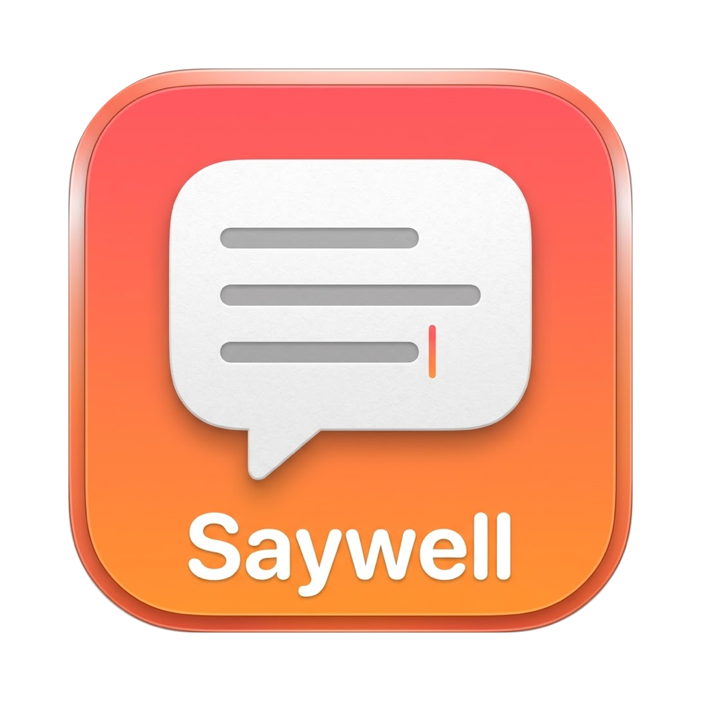
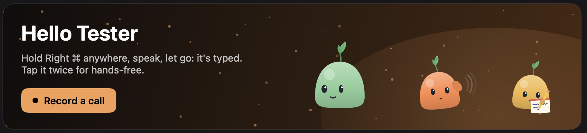
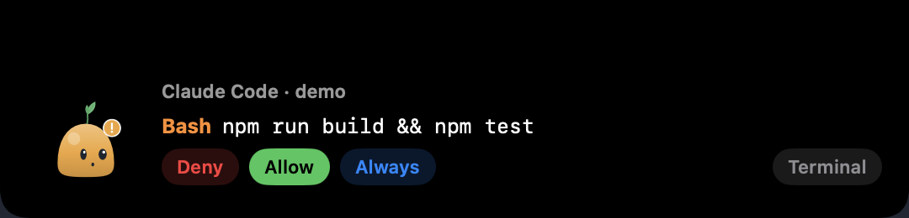
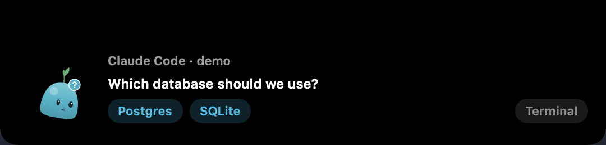
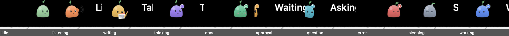
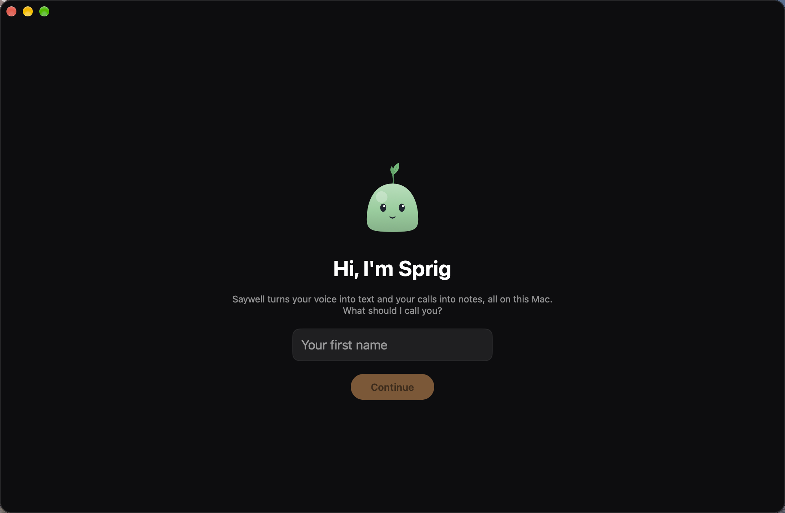
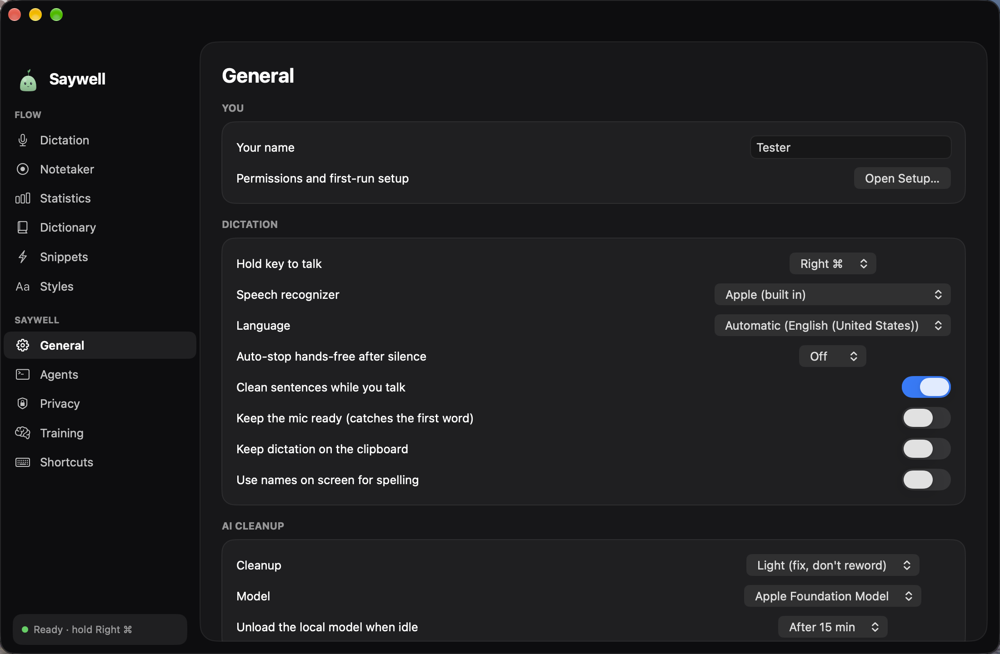

<div align="center">



# Saywell

**Private voice typing, call notes and a tiny friend in your Mac's notch.**

Hold a key anywhere, speak, let go: your words are typed where you are, cleaned up by a model that runs on your Mac.
Record a meeting without a bot and get the transcript person by person, a summary, decisions and action items.
Approve Claude Code from the notch. Meet **Sprig**, who listens while you talk and takes notes during your calls.




</div>

---

## Why

Dictation apps that clean up your words usually send your voice to a server. Saywell doesn't. Speech
recognition (Apple's on-device recognizer or NVIDIA's Parakeet on the Neural Engine) and the clean-up model
(Qwen3 4B through MLX, or Apple's Foundation Model) all run on your Mac. There is no account, no telemetry,
and the app has no network connection open while you use it: the only network use is a model download you
approve, pinned to one revision and checked by SHA-256. See [PRIVACY.md](PRIVACY.md) for how to verify it.

## Features

### 🎙️ Dictation
- **Hold to talk** with Fn, right ⌥, right ⌘ or right ⌃. **Tap twice** for hands-free, **Esc** to cancel,
  **⌃⌘V** to paste the last dictation again, **⌃⌥Z** to put back exactly what you said.
- **Clean-up that keeps your words**: fillers, repeats and punctuation are fixed; a faithfulness check rejects
  any model output that adds, drops or answers something. Numbers, money, times, emails and handles are
  formatted by rules ("twenty five dollars sorry no thirty" → "$30").
- **Spoken corrections** ("…at three, no, change that to four"), lists, snippets, a personal dictionary that
  learns from the fixes you make, writing **styles per app or website**, and edits by voice on selected text
  ("make this more formal").
- **Two recognizers**: Apple's (default) or **Parakeet v3** (about half the errors in our tests, 25 languages).
- **Languages**: any language installed for offline dictation in macOS, or Parakeet's 25.

### 📝 Notetaker
- **Record a call** from the window, the menu or the pill: your microphone and what your Mac plays (Core Audio
  process tap), so **no bot joins**. Or let Saywell **auto-record** when Zoom, Teams or Webex starts a meeting
  (ask first in the notch, or always), and stop when it ends.
- A live transcript while you talk, then the full transcript **person by person** (Parakeet + a pinned
  speaker-separation model), **cleaned up** by the local model (the original is kept), and notes:
  **summary, key points, decisions, action items with owner and due date, open questions**.
- The audio is deleted as soon as the transcript is written. Export any note as Markdown.

### 🤖 Claude Code in the notch
- Permission requests appear in the notch with **Allow / Deny / Always / Terminal**; `AskUserQuestion` shows its
  options as buttons. Answer in the terminal instead and the card goes away.
- Connects through Claude Code hooks and a local Unix socket. Saywell shows you exactly what it writes to
  `~/.claude/settings.json` before writing it, keeps a backup, and removes only its own entries.

<table>
<tr>
<td width="50%"></td>
<td width="50%"></td>
</tr>
</table>

### 🌱 Sprig
A character drawn entirely in code (no images): pose numbers, keyframe animations and a table of states, ported
from [sprig_character.md](sprig_character.md). Sprig **listens** with a hand to its ear while you dictate (its
mouth and the sound arcs follow your voice), **writes** on a notepad while a call is recorded, thinks while
your text is polished, cheers when it's typed, hops when Claude Code needs you, follows your mouse, gets dizzy
if you poke it three times, and falls asleep when you're away.



### 🪟 The Saywell window
Opening Saywell shows its window: it asks your name the first time, then shows your dictation history (search,
copy, delete), stats (words, words per minute, days in a row, time saved), your notes, and every setting.

<table>
<tr>
<td width="50%"></td>
<td width="50%"></td>
</tr>
</table>

### 💊 The pill
In the notch by default, or at the bottom or an edge of the screen (for external displays), with nine dots that
follow your voice from low to high pitch. Hover the bottom pill for Dictate, Record a call and Settings.

## Requirements

| | Minimum | Recommended |
|---|---|---|
| Mac | Apple silicon (M1 or newer) | M2 or newer, 16 GB for the local Qwen3 model |
| macOS | 14 Sonoma (call recording needs 14.2) | 26 Tahoe or newer, with Apple Intelligence on, for Apple's model |
| Disk | ~110 MB for the app | +2.3 GB Qwen3, +460 MB Parakeet, +22 MB speaker model (each downloaded only if you choose it) |
| To build | Xcode 26 with the Metal toolchain | |

## Install

### Build from source
```bash
git clone https://github.com/gouravkumar525/saywell.git
cd saywell
Scripts/make_app.sh          # builds and signs build/Saywell.app (xcodebuild; MLX needs Xcode's Metal toolchain)
open build/Saywell.app
```
`make_app.sh` signs with a local certificate named **"LocalFlow Dev"** when it exists, so macOS keeps your
permissions across rebuilds (create one in Keychain Access ▸ Certificate Assistant ▸ Create a Certificate, type
Code Signing). Without it the app is signed ad hoc and macOS asks for permissions again after each build.

### Package to share
```bash
Scripts/package.sh                          # dist/Saywell-1.0.dmg and .zip
Scripts/package.sh --with-model parakeet    # include Parakeet so the other Mac never downloads it
```
See [INSTALL.md](INSTALL.md) for installing on another Mac, updates and uninstalling.

### Permissions (asked the first time)
| Permission | Why |
|---|---|
| Microphone, Speech Recognition | To hear and recognize you |
| Accessibility | To type into the app you're in and read the text around the cursor |
| Input Monitoring | To notice the hold key |
| System Audio Recording | Only for recording calls: to hear the other people |
| Automation (Music, Spotify) | Only if you turn on "Pause music while dictating" |

Set **System Settings ▸ Keyboard ▸ Press 🌐 key to ▸ Do Nothing** if you hold Fn.

## Use

| Do | How |
|---|---|
| Dictate | Hold the hold key (Fn by default), speak, let go |
| Hands-free | Tap the hold key twice; tap once more to finish. Or ⌃⌥D |
| Cancel / paste again / raw | Esc / ⌃⌘V / ⌃⌥Z |
| Record a call | Window ▸ Record a call, menu ▸ Record a Call…, or the bottom pill |
| Auto-record meetings | General ▸ Notetaker, or menu ▸ Auto-Record Meetings (Ask / Always) |
| Connect Claude Code | Window ▸ Agents ▸ Connect Claude Code… |
| Change any setting | Window ▸ General (or the menu-bar Sprig) |

## Models

| Model | Used for | Runs on | Licence |
|---|---|---|---|
| Apple speech recognizer | Dictation (default) | On-device, part of macOS | Apple |
| [Parakeet TDT 0.6B v3](https://huggingface.co/FluidInference/parakeet-tdt-0.6b-v3-coreml) | Dictation (optional), call transcripts | Neural Engine (Core ML, FluidAudio) | CC-BY-4.0 |
| [Qwen3-4B-Instruct-2507 4-bit](https://huggingface.co/mlx-community/Qwen3-4B-Instruct-2507-4bit) | Clean-up, call notes | GPU (MLX) | Apache-2.0 |
| Apple Foundation Model | Clean-up, call notes (fallback) | On-device, part of macOS 26 | Apple |
| [pyannote Community-1 (Core ML)](https://huggingface.co/FluidInference/speaker-diarization-coreml) | Telling voices apart in calls | Neural Engine | CC-BY-4.0 |

Every downloadable model is pinned to a revision with each file's size and SHA-256
(`Sources/LocalFlowCore/ModelManifests.swift`, generated by `Scripts/pin_models.py`).

## Development

```bash
Scripts/build_check.sh     # quick compile check
Scripts/test.sh            # 215 unit tests (prints every failure, then the totals)
Scripts/e2e_test.sh        # live: speaks through the speakers, dictates into a test window
build/Saywell.app/Contents/MacOS/Saywell --make-call /tmp/call && \
  build/Saywell.app/Contents/MacOS/Saywell --note-test /tmp/call --engine qwen3   # the Notetaker pipeline on a scripted call
```

Layout: `Sources/LocalFlowCore` holds the logic with no UI (rules, prompts, faithfulness check, notes builder,
Sprig's engine, the Claude Code protocol; all unit-tested). `Sources/LocalFlow` is the app (audio, recognizers,
models, notch, window). The Swift targets keep the project's original code name, LocalFlow.
More: [ARCHITECTURE.md](ARCHITECTURE.md), [docs/accuracy.md](docs/accuracy.md) (every accuracy decision and its
evidence), [eval/RESULTS.md](eval/RESULTS.md) (benchmarks), [STATUS.md](STATUS.md).

## Credits

Made by Gourav Kumar.

## Licence

No licence has been chosen yet, so all rights are reserved by the author. Third-party code and models keep their
own licences (see [THIRD_PARTY_NOTICES.md](THIRD_PARTY_NOTICES.md)).
